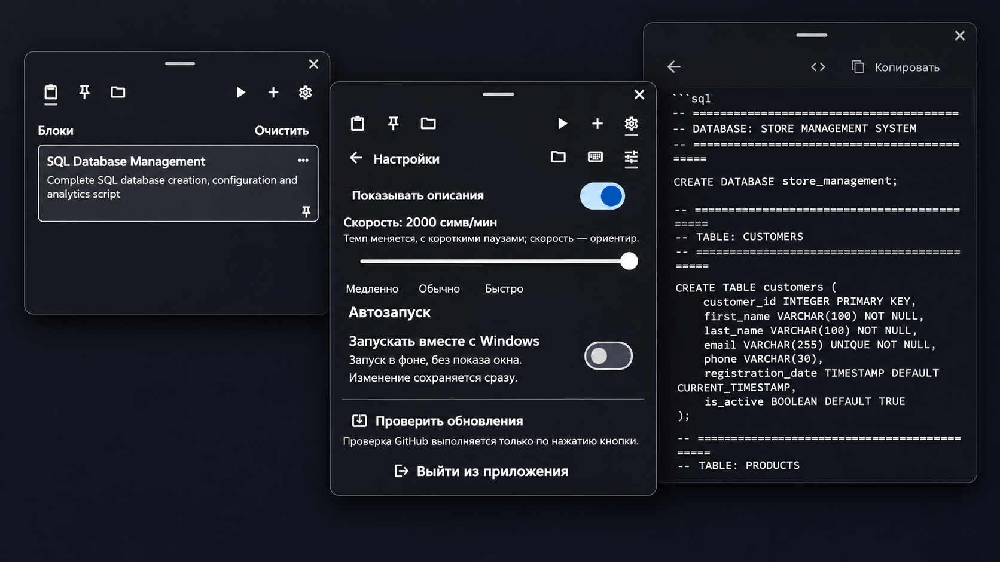

# Привет! Это Helper 👋

**Подготовленный текст — перед глазами, а не на демонстрации.**

[Скачать для Windows](https://github.com/Mishaell03/helper/releases/latest) · [Сообщить об ошибке](https://github.com/Mishaell03/helper/issues)

Helper — компактное приложение для Windows, которое позволяет незаметно для
совместимого захвата экрана просматривать подготовленный текст или автоматически
вводить его в другое приложение.

Импортируйте `.md` и `.txt`, закрепляйте нужные блоки и держите их под рукой
в полупрозрачной панели поверх окон. Для автоввода есть настройка скорости,
пауза, продолжение и горячие клавиши. Тексты и настройки хранятся локально.

> Скрытие панели зависит от способа захвата — перед демонстрацией проверьте его
> пробной записью. Текст, введённый в другое приложение, остаётся видимым.

## Как это выглядит

## Лицензия

Проект распространяется под **[GNU GPL-2.0-only](https://www.gnu.org/licenses/old-licenses/gpl-2.0.html)**.
Можно использовать, изменять и распространять программу с соблюдением условий лицензии.
